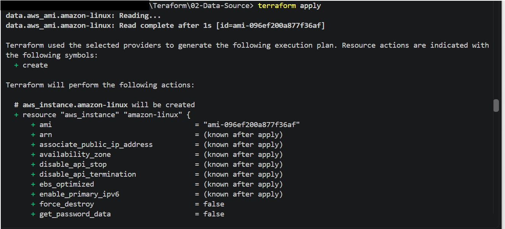
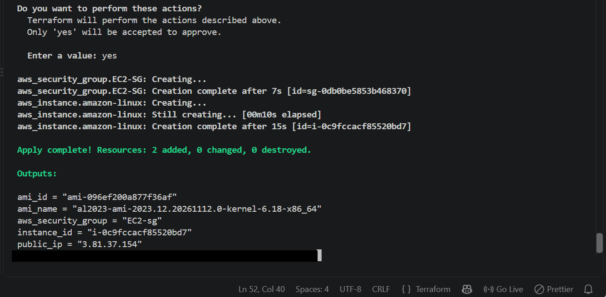
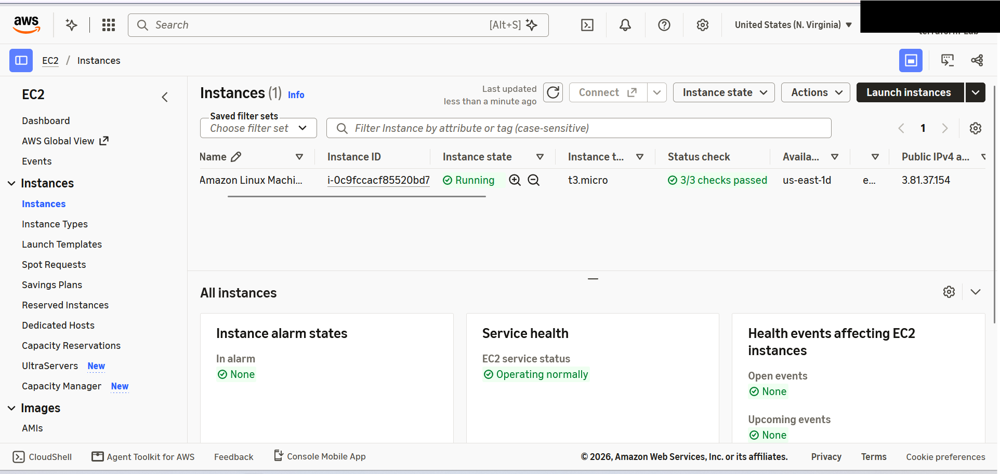
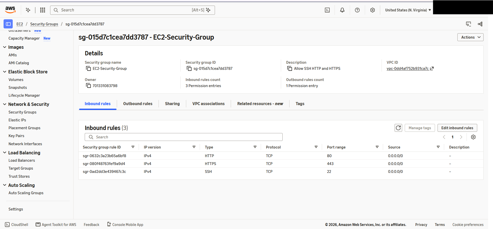
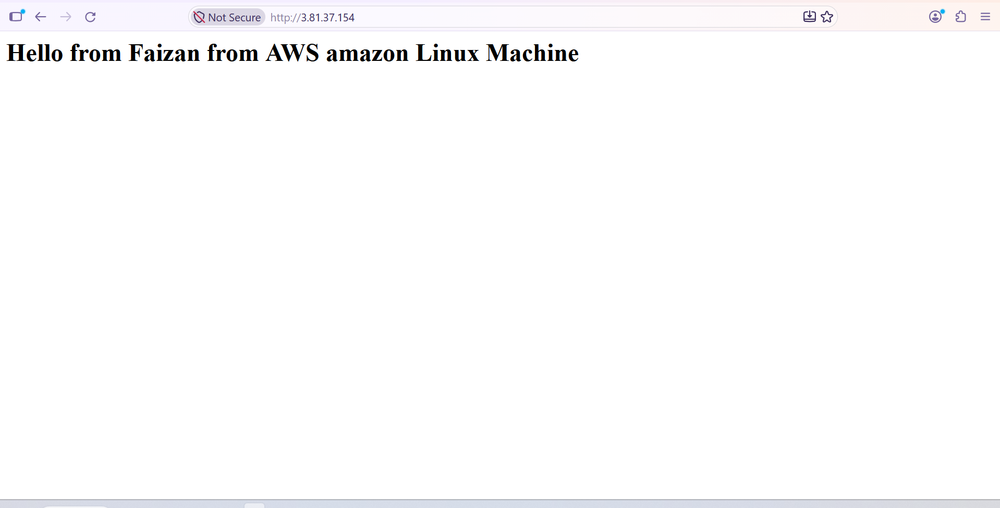

# Terraform EC2 Deployment – Amazon Linux 2023

## Project Overview

This project demonstrates how to provision an Amazon EC2 instance running **Amazon Linux 2023** using Terraform (Infrastructure as Code).

Instead of manually creating AWS resources through the AWS Management Console, Terraform automates the deployment of the required infrastructure.

The configuration uses an AMI data source to dynamically retrieve the specified Amazon Linux 2023 AMI, creates a Security Group, and deploys an EC2 instance with a startup script (`user_data.sh`).

## Technologies Used

- **Cloud Provider:** AWS
- **Infrastructure as Code:** Terraform
- **Compute Service:** Amazon EC2
- **Operating System:** Amazon Linux 2023
- **Networking:** AWS Security Groups
- **Automation:** EC2 User Data (Shell Script)
- **Version Control:** Git & GitHub

## Project Structure

```text
02-EC2-Amazon-Linux/
│
├── main.tf
├── variables.tf
├── outputs.tf
├── provider.tf
├── user_data.sh
├── terraform.tfvars
├── .gitignore
└── README.md
```

## Infrastructure Components

### 1. AMI Data Source

Used Terraform's `aws_ami` data source to retrieve the Amazon Linux 2023 AMI.

- Retrieves the most recent matching AMI.
- Uses the official Amazon owner ID.
- Filters the AMI using its specified name.
- Passes the retrieved AMI ID to the EC2 resource.

### 2. Security Group

Created an AWS Security Group to control inbound and outbound traffic.

| Protocol | Port | Access |
|---|---:|---|
| SSH | 22 | Allowed |
| HTTP | 80 | Allowed |
| HTTPS | 443 | Allowed |
| All outbound traffic | All | Allowed |

### 3. EC2 Instance

Provisioned an EC2 instance with the following configuration:

- **AMI:** Amazon Linux 2023
- **Instance Type:** Configurable through Terraform variables (Default: `t3.micro`)
- **Key Pair:** Existing AWS Key Pair (`EC2_kp`)
- **Security Group:** Terraform-managed Security Group
- **User Data:** Executes the `user_data.sh` startup script.
- **Name Tag:** Amazon Linux Machine

### 4. Terraform Output Variables

Configured output variables to display important information after deployment.

- AMI ID
- AMI Name
- EC2 Instance ID
- EC2 Public IP
- Security Group Name

## Deployment Process

### Step 1: Initialize Terraform

```bash
terraform init
```

Downloads the required AWS provider and initializes the working directory.

### Step 2: Validate Configuration

```bash
terraform validate
```

Checks the Terraform configuration for syntax and configuration errors.

### Step 3: Review Execution Plan

```bash
terraform plan
```

Displays the infrastructure changes Terraform intends to perform.

### Step 4: Deploy Infrastructure

```bash
terraform apply
```

Creates the AWS Security Group and EC2 instance.

### Step 5: View Outputs

```bash
terraform output
```

Displays the configured output values, including the EC2 public IP.

### Step 6: Destroy Infrastructure

```bash
terraform destroy
```

Removes the infrastructure provisioned by Terraform.

## Screenshots

### 1. Terraform Deployment



### 2. Output Variables 



### 3. EC2 Instance Output



### 4. Security Group Configuration



### 5. Apache Output



## Key Learnings

Through this project, I gained hands-on experience with:

- Using Terraform data sources to retrieve existing AWS resources.
- Automating AWS Security Group creation.
- Deploying EC2 instances using Terraform.
- Referencing resources and data sources within Terraform configurations.
- Using input variables to make configurations reusable.
- Using EC2 User Data for instance initialization.
- Defining Terraform output variables.
- Managing AWS infrastructure through Infrastructure as Code.

## Conclusion

This project demonstrates the practical use of Terraform to automate AWS infrastructure provisioning. It reduces manual configuration, improves consistency, and provides a repeatable approach to deploying cloud resources.

**Author:** Faizan Afzal

**GitHub:** [GitHub Profile](https://github.com/)