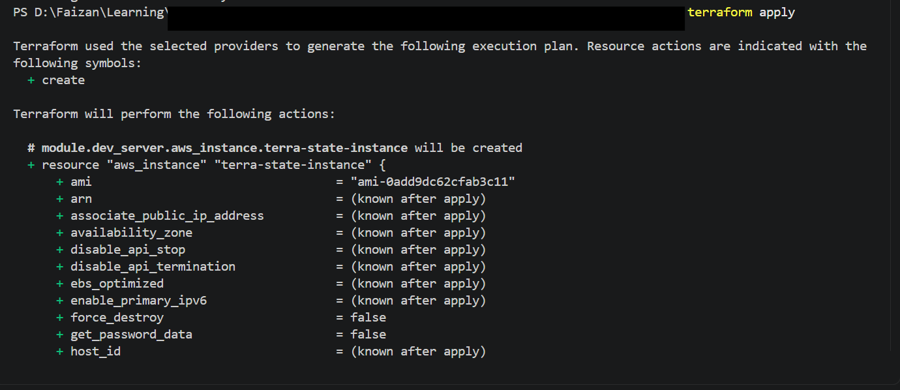
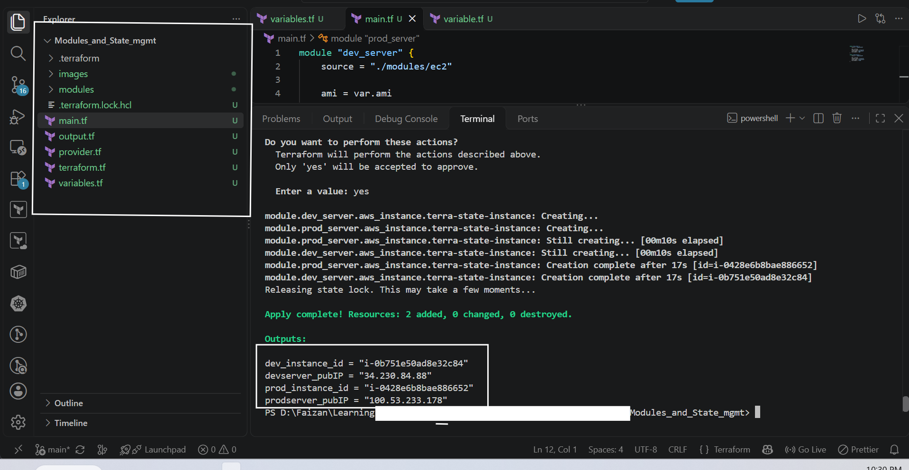
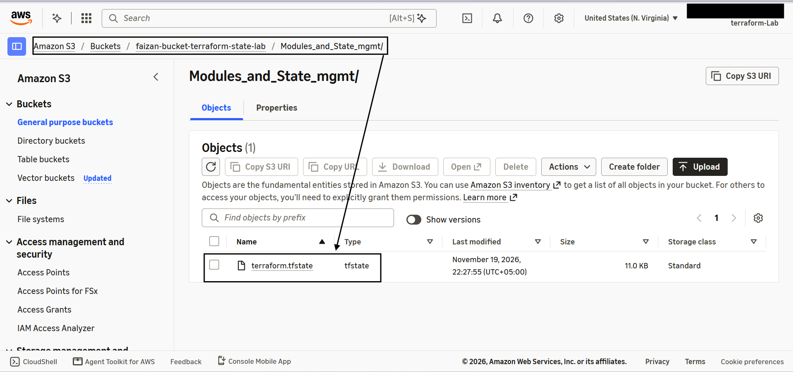
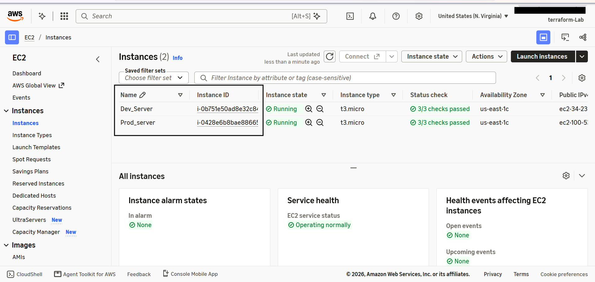

# Terraform Modules & Remote State Management on AWS

## Project Overview

This project demonstrates how to build reusable AWS infrastructure using Terraform Modules and manage Terraform state remotely using an Amazon S3 backend.

The project follows a modular approach by creating a reusable EC2 module and deploying multiple EC2 instances with different configurations.

It also implements centralized state management using Amazon S3, including bucket versioning, server-side encryption, and native S3 state locking to prevent concurrent modifications.

## Technologies Used

- Terraform
- AWS
- Amazon EC2
- Amazon S3
- Terraform Modules
- Remote State Management
- S3 Native State Locking
- HCL

## Project Architecture

The project consists of two main directories:

**01-Backend-Setup**

Responsible for creating the S3 bucket used for remote Terraform state storage.

**02-Infrastructure**

Contains the main infrastructure configuration and reusable EC2 module. It uses the S3 backend created in the first directory.

## Project Structure

```text
Terraform/
│
├── 01-Backend-Setup/
│   ├── main.tf
│   ├── variables.tf
│   ├── outputs.tf
│   └── providers.tf
│
└── 02-Infrastructure/
    ├── main.tf
    ├── variables.tf
    ├── outputs.tf
    ├── providers.tf
    ├── terraform.tf
    │
    └── modules/
        └── ec2/
            ├── main.tf
            ├── variables.tf
            └── outputs.tf
```

## Key Implementations

### 1. S3 Backend Setup

Created a dedicated S3 bucket to store Terraform state remotely.

Implemented the following configurations:

- S3 bucket creation
- Bucket versioning enabled
- Server-side encryption using AES-256
- S3 Block Public Access
- Bucket ownership controls
- Lifecycle protection using `prevent_destroy`

### 2. Reusable Terraform Modules

Created a reusable EC2 module containing:

- `main.tf` – EC2 resource configuration
- `variables.tf` – Input variables
- `outputs.tf` – Resource outputs

The same module was called multiple times from the root module to deploy different EC2 instances.

### 3. EC2 Deployment

Deployed two EC2 instances using the same reusable module.

| Configuration | Development | Production |
|---|---|---|
| Instance Name | Dev-Server | Prod-Server |
| Instance Type | t2.micro | t2.large |
| Environment | dev | prod |
| Terraform Module | ec2 | ec2 |

The EC2 module accepts AMI ID, instance type, server name, and environment as input variables.

### 4. Remote State Management

Configured Amazon S3 as the Terraform remote backend.

The infrastructure state is stored centrally in an S3 bucket instead of the local project directory.

Implemented:

- Centralized remote state storage
- Separate state file using an S3 object key
- S3 server-side encryption
- S3 bucket versioning

### 5. State Locking

Implemented native S3 state locking using:

```hcl
use_lockfile = true
```

This prevents multiple Terraform operations from modifying the same state simultaneously.

Terraform automatically creates and releases a temporary `.tflock` object during supported state operations.

## Terraform Commands Used

```bash
# Initialize Terraform
terraform init

# Validate configuration
terraform validate

# Review execution plan
terraform plan

# Deploy infrastructure
terraform apply

# Display managed resources
terraform state list

# Inspect a resource
terraform state show module.dev_server.aws_instance.server

# Retrieve remote state
terraform state pull

# Destroy infrastructure
terraform destroy
```

## Screenshots

### 1. Terraform Deployment


### 2. Terraform Outputs


### 3. S3 Remote State Bucket


### 4. EC2 Instances



## Key Learnings

Through this project, I gained practical experience with:

- Creating reusable Terraform modules.
- Understanding root modules and child modules.
- Passing input variables to modules.
- Retrieving outputs from child modules.
- Deploying multiple EC2 instances using a single reusable module.
- Configuring Amazon S3 as a remote Terraform backend.
- Implementing native S3 state locking.
- Understanding state files and resource tracking.
- Exploring Terraform state commands.
- Understanding the importance of state versioning and infrastructure collaboration.

## Project Outcome

Successfully deployed multiple AWS EC2 instances using a reusable Terraform module and configured centralized remote state management through Amazon S3 with native state locking.

This project demonstrates a modular and collaborative approach to managing AWS infrastructure using Infrastructure as Code (IaC).

## Important Notes

- AWS credentials are configured separately and are not stored in this repository.
- Terraform state files and the `.terraform` directory should not be committed to GitHub.
- The S3 backend bucket must be created before initializing the infrastructure project.
- The backend setup project maintains its own local Terraform state.
- The infrastructure project uses the S3 remote backend.

